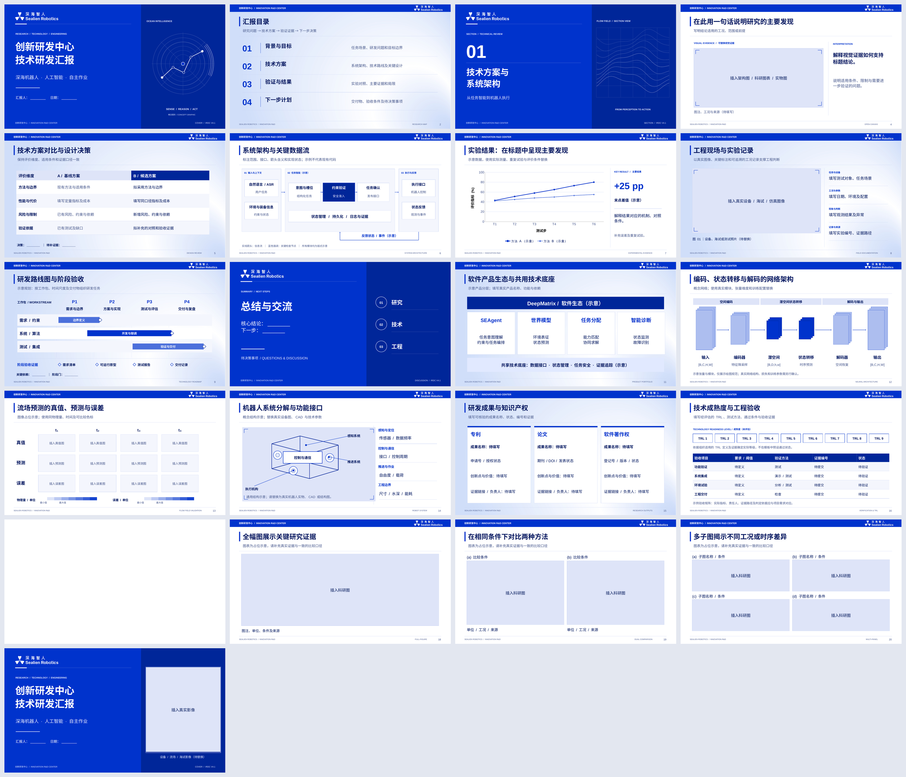
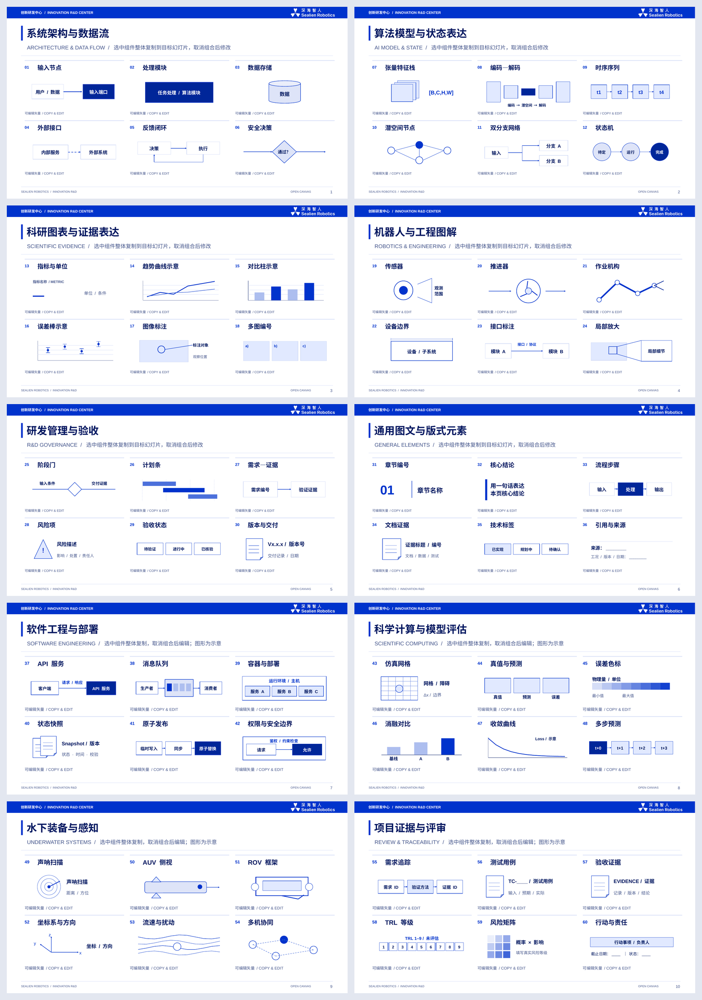

# Sealien-RD-DesignSystem

**Sealien Robotics Innovation R&D Center (创新研发中心) — Department-wide Visual Design System, Engineering Presentation Templates, Editable Vector Components, and AI Asset Workflows.**

## 1. Architecture: Build in Git, Consume in Team Knowledge Base

- **GitHub / GitLab (Source of Truth)**: Manages design tokens, master templates, component libraries, guidelines, validation scripts, and tagged Releases (`V4.1.0`).
- **SharePoint / Feishu / Internal NAS (Team Distribution)**: Consumes audited assets packaged by `automation/build_release.py` (`dist/V4.1.0/`) so colleagues always download an approved Release without maintaining diverging copies.

## 2. Repository Structure

```text
Sealien-RD-DesignSystem/
├── brand/
│   ├── logos/sealien_logo.png
│   ├── backgrounds/original_brand_gradient.png
│   ├── colors.json
│   ├── typography.json
│   └── theme/
│       ├── Sealien_RD_Theme_V4.1.0.thmx
│       ├── theme1.xml
│       ├── color_scheme.xml
│       └── font_scheme.xml
├── templates/
│   ├── powerpoint/
│   │   ├── Sealien_RD_Template_V4.1.0.potx   # End-user presentation template (21 layouts)
│   │   └── Sealien_RD_Master_V4.1.0.pptx     # Master deck for maintainers
│   ├── word/                                 # Planned
│   ├── excel/                                # Planned
│   └── latex/                                # Planned
├── components/
│   ├── Sealien_RD_Components_V4.1.0.pptx     # 10-page deck, 60 editable vector groups
│   ├── architecture/
│   ├── scientific-visualization/
│   ├── robotics/
│   └── project-management/
├── guidelines/
│   ├── Sealien_RD_UserGuide_V4.1.0.pdf       # 3-page team guide (embedded YaHei/Arial fonts)
│   ├── design-guidelines.md
│   ├── presentation-guidelines.md
│   └── release-checklist.md
├── previews/
│   ├── layouts.png                           # 21 standard slide layouts preview
│   └── components.png                        # 60 editable component groups preview
├── validation/
│   └── structural_validation.json
├── automation/
│   ├── validate_ppt.py                       # OOXML, ID bounds, rels, brand & PDF check
│   └── build_release.py                      # Deterministic Release pack + SHA256SUMS.txt
├── skills/
│   └── sealien-rd-ppt/                       # AI agent skill (SKILL.md + prompts + refs)
├── ASSET_MANIFEST.json
├── CHANGELOG.md
├── CONTRIBUTING.md
└── SECURITY.md
```

## 3. Quick Start

### For Team Presenters
1. Double-click `templates/powerpoint/Sealien_RD_Template_V4.1.0.potx` (or download from the `V4.1.0` Release) to start a new deck without editing the shared master.
2. Open `components/Sealien_RD_Components_V4.1.0.pptx`, copy individual component groups (`可复用组件 01`–`60`), paste into your slides, and ungroup to edit.
3. Read `guidelines/Sealien_RD_UserGuide_V4.1.0.pdf` for layout selection (`01`–`21`), file naming (`项目名称_汇报主题_YYYYMMDD_Vx.y.z.pptx`), and scientific figure conventions.
4. Ensure **Microsoft YaHei** and **Arial** are installed locally (font binaries are not bundled).

### For Maintainers & Release Validation
```bash
# 1. Validate OOXML packages, shape IDs, brand asset hashes, manifest, and PDF font embedding
python automation/validate_ppt.py

# 2. Build deterministic V4.1.0 release assets + ZIP + SHA256SUMS.txt into dist/V4.1.0/
python automation/build_release.py --version V4.1.0
```

## 4. V4.1.0 Highlights

- **21 standard 16:9 layouts** covering general R&D reviews, software ecosystems, neural architectures, flow-field error comparisons, robotics decomposition, IP/outputs, and TRL acceptance matrices.
- **60 editable vector component groups** across 10 engineering categories.
- **Byte-identical brand identity**: preserves original `sealien_logo.png`, `original_brand_gradient.png`, and V4.0 brand colors (`#0033CC`, `#002699`, `#001760`, `#E1E9FF`, `#FFFFFF`).
- **Native Windows PowerPoint 16 verified**: fixed `slideMaster1.xml` signed-INT32 shape ID compatibility (`2147483671` → `2`), exported native `.thmx` theme (`Sealien_RD_Theme_V4.1.0.thmx`), and regenerated `Sealien_RD_UserGuide_V4.1.0.pdf` with embedded CJK/Latin fonts.

## 5. Previews




